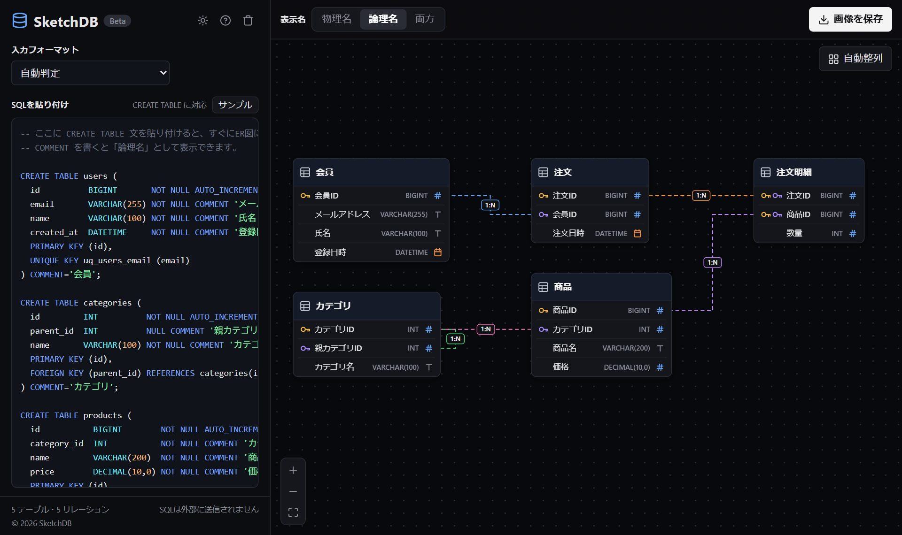

# SketchDB

CREATE TABLE 文を貼り付けるだけで、すぐにER図を作成できる無料のWebツールです。

**▶ https://hikaru1309.github.io/sketchdb/**

## 特徴

- MySQL・PostgreSQL・MariaDB・SQL Server・SQLite に対応（自動判定）。mysqldump・pg_dump・SQLite の .dump・SSMS のスクリプトの出力もそのまま貼れます
- `COMMENT` を論理名として表示（物理名・論理名・両方を切り替え）
- テーブルはドラッグで移動でき、配置はブラウザに保存されます
- 画面でテーブルを追加・編集・削除、線を引いて外部キーを作る、元に戻す・やり直し（SQLは編集したテーブルの部分だけ書き換わります）
- PNG / SVG で書き出し、Mermaid（GitHub の README や Qiita にそのまま貼れる書き方）でコピー
- テーブル定義書（Excel・Markdown コピー・CSV・印刷 / PDF）
- テーブル検索（名前・論理名・列名）、URLで図を共有（SQLはURLの # の後ろに入り、サーバーには送られません）
- ダーク / ライト切り替え、スマホ対応
- SQLはブラウザの中だけで処理され、外部に送信されません

ご意見・不具合の報告は [こちらのフォーム](https://forms.gle/hGxAKpNa1odaFe4V9) からお願いします。

---

このリポジトリには、公開用にビルドしたファイルだけが入っています。
